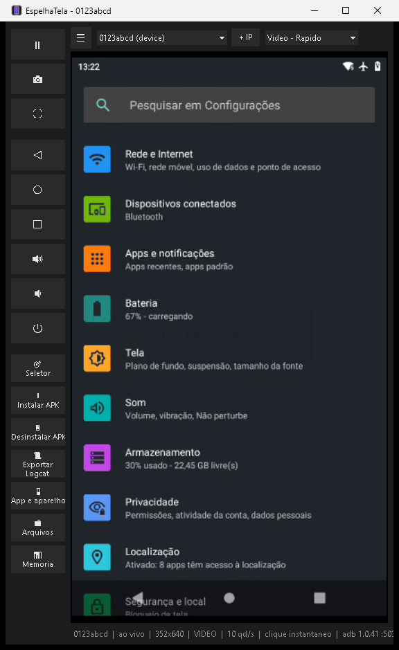
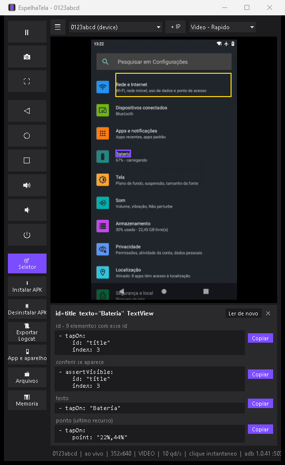

<h1 align="center">Vision</h1>

<p align="center"><sub>antigo EspelhaTela</sub></p>

<p align="center">
  <b>Espelhe e controle um aparelho Android direto no Windows, numa janela própria.</b><br>
  Feito para quem testa apps no dia a dia: QA, automação de testes e desenvolvimento mobile.
</p>

<p align="center">
  
  
  
  
  <a href="LICENSE"></a>
</p>

<p align="center">
  
  &nbsp;&nbsp;
  
</p>

<p align="center"><i>À esquerda, o espelho com vídeo fluido e clique instantâneo. À direita, o <b>Seletor</b>: clique num elemento e copie o seletor do Maestro.</i></p>

---

## ✨ Destaques

- **Fluido de verdade.** Vídeo H.264 com dezenas de quadros por segundo, e o toque chega ao aparelho na hora por um injetor que fica sempre ativo (a mesma técnica do scrcpy).
- **Seletor para o Maestro.** Clique em qualquer botão ou texto da tela e copie `id:`, `text:`, `assertVisible` ou `point:` prontos para colar no YAML. Se o id se repete, a sugestão já vem com `index:`.
- **Não derruba a sua automação.** Usa o mesmo `adb` do Android SDK, nunca reinicia o servidor adb e avisa quando outro adb ou outra porta podem dar conflito.
- **O `adb` sem terminal.** Instalar e desinstalar APK, gerenciador de arquivos, monitor de memória, exportação de logcat, conexão por IP e preparo do aparelho para automação, cada um a um clique.
- **Funciona em qualquer aparelho.** Cada parte tem plano B automático: sem vídeo, ele usa quadros; sem injetor, usa o `adb shell input`.

## 🚀 Comece em 1 minuto

**Pelo instalador:**
1. Baixe o instalador `Vision-Setup-<versão>.exe` em [**Releases**](../../releases) e instale. Não pede administrador. Se preferir sem instalar, use o `Vision-<versão>.zip`.
2. Ligue a **depuração USB** no aparelho e conecte-o ao PC.
3. Abra o **Vision** pelo Menu Iniciar. A primeira abertura leva de 10 a 15 s.

Você precisa do `adb` do [Android SDK Platform-Tools](https://developer.android.com/tools/releases/platform-tools). Ele é procurado sozinho na variável `ADB`, no `PATH`, em `ANDROID_SDK_ROOT`/`ANDROID_HOME`, em `%LOCALAPPDATA%\Android\Sdk` ou ao lado do `.exe`.

**A partir do código:**

```bash
git clone https://github.com/beterraba409/EspelhaTela.git
cd EspelhaTela
pip install pillow av
python espelha_tela.py
```

## 🧰 O que tem

| | Recurso | Para que serve |
|---|---|---|
| 🖥️ | **Espelho + controle** | Clique, arraste, rolagem e teclado do PC vão para o aparelho. Modos Vídeo (Rápido, Equilibrado, Nítido) ou Quadros (leve). |
| 🎯 | **Seletor** (F6) | O mouse destaca o elemento sob ele, e o clique escolhe o elemento em vez de tocar no aparelho. As sugestões são `id:` (o `resource-id`; no React Native, o `testID`), o id do elemento clicável que o contém, `text:`, accessibilityLabel, `assertVisible` e `point:`. |
| 📱 | **App e aparelho** | Para qualquer app instalado: versão, datas, PID, abrir, parar, reiniciar, limpar dados, conceder permissões e marcar como **★ favorito**. Do aparelho: modelo, Android, bateria, IP e ANDROID_ID. |
| 🤖 | **Preparar para automação** | Desliga as animações, mantém a tela ligada e trava a rotação. Guarda os valores antigos para restaurar com um clique. |
| 📦 | **Instalar / Desinstalar APK** | `adb install -r` com tratamento de downgrade e desinstalação de vários pacotes de uma vez. Também dá para **soltar o APK em cima do espelho**. |
| 📁 | **Arquivos** | Navegar, baixar e enviar com barra de progresso e Cancelar, **arrastar arquivos do Explorer** para a pasta aberta, abrir no PC, criar pasta, renomear e excluir (em `/sdcard`, `/storage` e `/data/local/tmp`). |
| 🎬 | **Gravar tela** | Grava o espelho em **MP4** ou **GIF** (até 60 s), com os **toques visíveis** se quiser, na pasta e com o nome que você escolher. |
| 📊 | **Memória** | Gerenciador de tarefas com RSS por processo, PSS sob demanda, variação desde o início, gráficos e exportação para CSV. |
| 🐞 | **Reportar bug** (F8) | Print, vídeo dos últimos 30 s, logcat e dados do aparelho/app numa pasta + `.zip`, com o texto do card do Jira (Descrição, Teste realizado, Resultado esperado e obtido) na área de transferência. |
| 📈 | **Logcat ao vivo** | Log em tempo real com filtro por app, nível e busca; pausar, limpar e salvar. |
| 📜 | **Exportar logcat** | O log dos últimos 2, 5 ou 10 minutos num arquivo, usando a hora do aparelho. |
| 🌐 | **Conectar pelo Wi-Fi** | Pelo IP (`adb connect`) ou **pareando com código** (Android 11+). O endereço fica salvo e é reconectado sozinho. |
| 🔌 | **Aviso de adb e porta** | Detecta um `adb.cmd` ou `ADB_SERVER_PORT` apontando para um servidor sem aparelhos e oferece **Usar a porta N**. |
| 📋 | **Copiar e colar** | **Ctrl+V** cola no aparelho o texto copiado no PC, com acentos. **Ctrl+C** copia a seleção do aparelho para o PC. O que um app copiar no aparelho (como o botão de copiar o serial) chega sozinho ao PC. **Botão direito** na tela copia o texto sob o mouse (até o que não dá para selecionar, como um serial) ou todo o texto da tela. |
| 📷 | **Captura e tela cheia** | PNG em `Imagens\Vision` (Ctrl+S) e tela cheia (F11). |

**Atalhos:** `Ctrl+V` cola no aparelho · `Ctrl+C` copia do aparelho · `F6` liga o seletor · `F8` reportar bug · `F9` mostra/oculta a barra lateral · `F11` tela cheia · `Ctrl+S` salva a captura · `Esc` sai do seletor.

## 🎯 Seletor para o Maestro: exemplo

Ligue o **Seletor**, clique em "Bateria" nas Configurações do Android, e ele sugere:

```yaml
- tapOn:
    id: "title"
    index: 3          # 9 elementos com esse id na tela

- tapOn: "Bateria"

- tapOn:
    point: "22%,44%"  # ultimo recurso
```

Em apps React Native, o `testID` aparece como `id:`, que é o seletor mais estável para os seus flows.

> ⚠️ O seletor lê a tela com `uiautomator dump`. Não use durante um flow do Maestro em andamento: os dois disputam o UiAutomation do aparelho.

## ⚡ Como ficou rápido

| Parte | Abordagem comum | Vision |
|---|---|---|
| Imagem | `screencap` quadro a quadro (cerca de 1 qd/s em aparelho fraco) | `screenrecord` H.264 decodificado com PyAV (dezenas de qd/s) |
| Toque | `adb shell input tap`: um processo novo e uma JVM a cada toque (0,5 a 1 s) | Injetor Java de ~3,5 KB sempre aberto no aparelho, com resposta em milissegundos |
| Retorno | Só quando a imagem atualiza | Um círculo aparece no ponto do clique na hora |
| Desenho | Todo quadro convertido e redimensionado | Só o quadro que vai para a tela, já no tamanho da janela, numa passada só |

## 🛠️ Para desenvolvedores

```bash
python espelha_tela.py --serial 0123abcd   # aparelho especifico
python espelha_tela.py --adb C:\caminho\adb.exe
python espelha_tela.py --abrir-app         # tambem --abrir-memoria e --abrir-arquivos
python espelha_tela.py --diagnostico       # relatorio em %TEMP%\vision-diagnostico.txt
python testes_sem_tela.py                  # verificacoes sem tela e sem aparelho
compilar.bat                               # gera dist\Vision.exe (PyInstaller, arquivo unico)
python injetor\build.py                    # recompila o injetor (JDK + Android SDK)
```

| Arquivo | Papel |
|---|---|
| `espelha_tela.py` | Janela (Tkinter), captura, controle e painéis |
| `seletor.py` | Árvore da tela e seletores do Maestro |
| `adb_servidor.py` | Porta do servidor adb e detecção de wrapper |
| `injetor/` | Fonte do injetor de toques (`espelhatela.Injector`) |

## ❓ Perguntas frequentes

<details>
<summary><b>A lista de aparelhos aparece vazia.</b></summary>

Confira se a depuração USB está ligada e se você aceitou "Permitir depuração" na tela do aparelho. Se o seu `adb` usa outra porta (por exemplo, um `adb.cmd` com `-P 5038`), a faixa amarela oferece **Usar a porta N**. O `--diagnostico` mostra o adb, a porta e os servidores encontrados.
</details>

<details>
<summary><b>O vídeo trava de vez em quando.</b></summary>

Use o vídeo por um tempo e, quando travar, clique em **Registro do vídeo** (seção Vision). Ele abre o `video.log`, que diz se a travada veio do aparelho (parou de mandar quadros), do PC (o vídeo chegou mas ficou esperando) ou da troca de gravação, e mostra o codificador de vídeo do aparelho, o processador e quantos quadros o próprio app desenhou. Se a causa for o aparelho, experimente o modo **Vídeo leve (aparelho fraco)**. Abra uma issue com esse arquivo.
</details>

<details>
<summary><b>O clique está lento ("clique via adb").</b></summary>

O firmware do aparelho bloqueou o injetor, e a ferramenta caiu para o `adb shell input`, que é mais lento mas funciona em qualquer aparelho.
</details>

<details>
<summary><b>O Windows ou o antivírus alertou sobre o .exe.</b></summary>

É um programa novo e sem assinatura digital. Libere em Propriedades > Desbloquear, ou rode a partir do código com `python espelha_tela.py`.
</details>

<details>
<summary><b>Posso usar durante uma rodada de automação?</b></summary>

Pode olhar à vontade: em rodadas longas, prefira o modo **Quadros (leve)**. Lembre-se de que os seus cliques mexem no aparelho de verdade, e de que o seletor não deve ser usado com um flow rodando.
</details>

## 📌 Limites conhecidos

- Texto com acentos não passa digitando pelo teclado do PC. Para isso, copie no PC e cole com `Ctrl+V`.
- O `screenrecord` grava no máximo 180 s seguidos. O Vision abre a gravação seguinte antes do fim e troca sem pausa; num aparelho que não aceita duas gravações ao mesmo tempo, fica uma pausa de cerca de 1 s a cada 3 minutos.
- Depois de girar a tela, pode ser preciso trocar o modo de captura e voltar.
- Alguns firmwares restringem o logcat ao shell. Nesse caso a exportação avisa em vez de gerar um arquivo vazio.

## 🗺️ Próximos passos

Gravação de vídeo e "replay" dos últimos segundos, um pacote de evidência de bug, vários aparelhos lado a lado e a gravação de um flow do Maestro a partir dos cliques. A lista completa está no [ROADMAP](ROADMAP.md).

## 🤝 Contribuindo

Sugestões, bugs e PRs são bem-vindos. Veja o [CONTRIBUTING](CONTRIBUTING.md).

---

### English (short)

**Vision** (formerly EspelhaTela, "mirror screen") is a Windows desktop app to mirror and control an Android device, in the spirit of Vysor/scrcpy, built for QA and test automation. It offers smooth H.264 video, instant touch through an always-on injector, and a **Maestro selector picker**: click any element and copy `id:`, `text:` or `point:`. It also bundles APK install/uninstall, a file manager, a memory monitor, logcat export, Wi-Fi adb and a "prepare device for automation" switch. It uses your SDK's `adb` and never restarts the adb server. To try it, download the installer (`Vision-Setup-<version>.exe`) from Releases or run `python espelha_tela.py`. MIT licensed. The UI is in Portuguese.

## Licença

[MIT](LICENSE) © Samuel Evaristo
